# Companion Framework — Architecture Specification

**Status:** architecture proposal, revision 2  
**Implementation language:** Python  
**Main technologies:** Pydantic / pydantic-settings, `typing.Protocol`, SQLite, Ollama, FastAPI (temporary adapter), PySide6/Qt (future desktop adapter)  
**Development tooling:** invoke, pytest, ruff, pre-commit, GitHub Actions (planned)

## What changed compared to revision 1

- `UIBuilder` moved out of the core into the Qt adapter: the core does not import PySide6.
- Added a **composition root** (`build_pipeline`): factories are used only there; controllers receive ready-made providers.
- `GfPipeline` depends on `MemoryManager` rather than directly on `IContextProvider`; `MemoryManager` is the single point for context handling and exchange persistence.
- `ExpressionManager` became a stateless validator; the active emotion belongs to the conversation/client, not to global state.
- Streaming generation has a typed contract (`StreamEvent`).
- Added a domain error hierarchy, an `ITool` contract (a placeholder for the local assistant), and fakes for tests.
- Added a development tooling section and an early Stage 0 (project skeleton).

## 1. Project Goal

Companion Framework is an independent Python library for building personal AI companions and local AI assistants. The initial scenario is a character with its own prompt, dialogue history, and visual emotions. The project is developed as a standalone module (including for a diploma thesis) with the prospect of being published as a library.

The core must be reusable through different interfaces: first FastAPI, later a Qt GUI, a CLI, and other clients. The library must not depend on FastAPI or Qt in its base core: these are adapters that call the core's public API.

### Goals

- Separate domain logic, configuration, providers, and interfaces.
- Support swapping LLM and database providers through stable contracts.
- Store dialogue history and reserve space for long-term memory and RAG (including integration with the existing RAG project).
- Separate the character's state/emotion from the text generation mechanism.
- Allow the core to be used without a graphical interface.
- Support testing components through substitutable implementations of the contracts.
- Reserve minimal room for the tools of a future local assistant.

### Non-goals of the first version

- Autonomous execution of arbitrary operating system commands.
- Mandatory RAG integration before the first MVP.
- Implementing assistant tools (the MVP has only a placeholder contract).
- Permanent lock-in to a single LLM provider, a single GUI, or a single configuration format.
- A complex plugin system with dynamic loading of third-party code.

## 2. Architectural Principles

1. **The core does not depend on the UI.** Qt and FastAPI import the core; the core does not import them.
2. **Dependencies point inward.** Domain models and contracts do not depend on concrete adapters.
3. **Providers are adapters.** `OllamaProvider` implements `ILLMProvider`; `SQLiteProvider` implements `IDatabaseProvider`.
4. **Factories create, controllers use.** Factories are called only in the composition root. Controllers receive ready-made providers in their constructors.
5. **The pipeline is a facade, not a "god object".** It coordinates services and lifecycle, but contains no SQL, HTTP code, or Qt window-building logic.
6. **Configuration is split by purpose.** Runtime settings and character configuration use different models.
7. **RAG is an optional context adapter.** The base scenario works with a window of recent messages.
8. **Asynchronous operations do not block the UI.** Network calls and generation are not executed synchronously in the Qt event loop; blocking libraries (e.g. `sqlite3`) are moved to an executor or replaced with async ones.
9. **Errors are typed.** Providers raise domain errors rather than raw library exceptions; adapters translate them into responses at their own level.
10. **Abstraction only for a real point of substitution.** Every contract and layer has its own responsibility or is needed for independent testing.

## 3. Class Diagram

The diagram is written in Mermaid and renders in GitHub, GitLab, Obsidian, and editors with Mermaid support.

```mermaid
classDiagram
direction TB

%% ===== Configuration =====
class Settings {
  +llm_provider: str
  +database_provider: str
  +database_url: str
  +model: str
  +context_window: int
  +request_timeout: float
  +log_level: str
}

class GfConfig {
  +character_id: str
  +name: str
  +system_prompt: str
  +expressions: dict
  +initial_expression: str
}

%% ===== Composition root =====
class CompositionRoot {
  +build_pipeline(settings, config) GfPipeline
}

%% ===== Facade =====
class GfPipeline {
  -config: GfConfig
  -ai_controller: AIController
  -memory_manager: MemoryManager
  -expression_manager: ExpressionManager
  +initialize() async
  +chat(message, conversation_id) async CharacterResponse
  +stream_chat(message, conversation_id) AsyncIterator~StreamEvent~
  +close() async
}

%% ===== LLM =====
class AIController {
  -provider: ILLMProvider
  +generate(request) async GenerationResponse
  +stream(request) AsyncIterator~StreamEvent~
}

class AIProviderFactory {
  +create(settings) ILLMProvider
}

class ILLMProvider {
  <<interface>>
  +generate(request) async GenerationResponse
  +stream(request) AsyncIterator~StreamEvent~
}

class OllamaProvider
class OpenAICompatibleProvider
class FakeLLMProvider

%% ===== Storage =====
class DatabaseController {
  -provider: IDatabaseProvider
  +initialize() async
  +create_conversation() async str
  +save_exchange(user_msg, assistant_msg) async
  +get_recent_messages(conversation_id, limit) async list~Message~
  +close() async
}

class DatabaseFactory {
  +create(settings) IDatabaseProvider
}

class IDatabaseProvider {
  <<interface>>
  +initialize() async
  +create_conversation() async str
  +save_message(message) async
  +save_exchange(user_msg, assistant_msg) async
  +get_recent_messages(conversation_id, limit) async list~Message~
  +close() async
}

class SQLiteProvider
class InMemoryDatabaseProvider

%% ===== Memory and context =====
class MemoryManager {
  -database: DatabaseController
  -context_provider: IContextProvider
  +build_context(conversation_id, user_message) async ContextBundle
  +record_exchange(user_msg, assistant_msg) async
}

class IContextProvider {
  <<interface>>
  +build_context(query, conversation_id) async ContextBundle
}

class ConversationWindowProvider {
  -database: DatabaseController
  -window: int
}

class RAGContextProvider {
  <<optional package>>
}

%% ===== Character =====
class ExpressionManager {
  -config: GfConfig
  +resolve(expression_id) str
  +asset_path(expression_id) Path
}

%% ===== Domain models =====
class Message {
  +id: str
  +conversation_id: str
  +role: Role
  +content: str
  +created_at: datetime
}

class GenerationRequest {
  +messages: list~Message~
  +model: str
  +params: dict
  +metadata: dict
}

class GenerationResponse {
  +content: str
  +usage: dict
  +metadata: dict
}

class StreamEvent {
  <<union>>
  TextDelta
  Done
  Error
}

class ContextBundle {
  +messages: list~Message~
  +memories: list~Memory~
}

class CharacterResponse {
  +text: str
  +expression: str
}

%% ===== Errors =====
class CompanionError {
  <<exception>>
}
class ProviderError
class GenerationTimeoutError
class StorageError
class ConfigError
class InvalidExpressionError

%% ===== Assistant tools (post-MVP) =====
class ITool {
  <<interface>>
  +name: str
  +description: str
  +args_schema: type
  +requires_permission: bool
  +run(args) async ToolResult
}

class ToolRegistry {
  +register(tool)
  +get(name) ITool
}

%% ===== Adapters (outside the core) =====
class FastAPIAdapter {
  +chat_endpoint()
  +stream_endpoint()
}

class QtDesktopAdapter {
  +run()
}

class UIBuilder {
  +build(pipeline, config) QApplication
}

%% ===== Relations: assembly =====
CompositionRoot ..> Settings : reads
CompositionRoot ..> GfConfig : reads
CompositionRoot ..> AIProviderFactory : uses
CompositionRoot ..> DatabaseFactory : uses
CompositionRoot ..> GfPipeline : assembles

%% ===== Relations: core =====
GfPipeline --> GfConfig : reads
GfPipeline --> AIController
GfPipeline --> MemoryManager
GfPipeline --> ExpressionManager

AIController --> ILLMProvider : uses
AIProviderFactory ..> ILLMProvider : creates
ILLMProvider <|.. OllamaProvider
ILLMProvider <|.. OpenAICompatibleProvider
ILLMProvider <|.. FakeLLMProvider

DatabaseController --> IDatabaseProvider : uses
DatabaseFactory ..> IDatabaseProvider : creates
IDatabaseProvider <|.. SQLiteProvider
IDatabaseProvider <|.. InMemoryDatabaseProvider

MemoryManager --> DatabaseController : uses
MemoryManager --> IContextProvider : uses
IContextProvider <|.. ConversationWindowProvider
IContextProvider <|.. RAGContextProvider
ConversationWindowProvider --> DatabaseController : reads history

ExpressionManager --> GfConfig : validates against

%% ===== Relations: models =====
AIController ..> GenerationRequest
AIController ..> GenerationResponse
ILLMProvider ..> StreamEvent
GfPipeline ..> CharacterResponse
IContextProvider ..> ContextBundle
GenerationRequest o-- Message
ContextBundle o-- Message

%% ===== Relations: errors =====
CompanionError <|-- ProviderError
CompanionError <|-- StorageError
CompanionError <|-- ConfigError
CompanionError <|-- InvalidExpressionError
ProviderError <|-- GenerationTimeoutError

%% ===== Relations: tools =====
ToolRegistry o-- ITool

%% ===== Relations: adapters =====
FastAPIAdapter ..> GfPipeline : consumes
QtDesktopAdapter ..> GfPipeline : consumes
QtDesktopAdapter --> UIBuilder : uses

note for ITool "Placeholder for the local assistant (post-MVP)"
note for RAGContextProvider "Wrapper around the existing RAG project; separate optional package"
note for UIBuilder "Lives in adapters/qt_desktop, not in the core"
```



### Notes on the diagram

- The diagram shows logical roles, not final Python signatures.
- `DatabaseController` is kept as a separate layer: it hosts storage error normalization, timeouts, and transaction orchestration. It does not depend on a concrete provider, so tests use the real controller with `InMemoryDatabaseProvider`. If during implementation the controller turns out to be an empty wrapper, it should be merged with the provider (principle 10).
- `MemoryManager` depends on `DatabaseController` and `IContextProvider`, but never on `SQLiteProvider`.
- `GfPipeline` does not create its dependencies itself: `CompositionRoot` assembles them.

## 4. Layers and Dependency Rules

| Layer | Contents | May import |
|---|---|---|
| `domain` | message and response models, errors | stdlib, Pydantic only |
| `contracts` | `ILLMProvider`, `IDatabaseProvider`, `IContextProvider`, `ITool` | `domain` |
| `config` | `Settings`, `GfConfig`, loading | `domain` |
| `application` | `GfPipeline`, controllers, `MemoryManager`, `ExpressionManager` | `domain`, `contracts`, `config` |
| `providers` | Ollama, SQLite, context providers | `domain`, `contracts`, third-party libraries |
| `factories` + `bootstrap` | factories, `build_pipeline` | everything above |
| `adapters` (outside the core) | FastAPI, Qt, CLI | the core's public API |

These rules should be enforced by an import test (e.g. forbidding `import PySide6` / `import fastapi` in `src/companion`).

## 5. Configuration Models

### 5.1 `Settings`

Built on `pydantic-settings`. Responsible for startup and infrastructure parameters:

- the type and parameters of the LLM provider;
- the type and parameters of the database provider;
- timeouts, logging, context limits;
- local API settings, if used.

Cloud provider secrets are stored as `SecretStr` and taken from environment variables or `.env` (which is not committed). Message content is not written to logs at INFO level.

### 5.2 `GfConfig`

Responsible for the character profile:

- a stable identifier and name;
- the system prompt;
- a dictionary `expression_id -> asset path`;
- the initial state (`initial_expression`);
- the format's `schema_version`;
- optional behavior and display parameters.

`GfConfig` does not create providers and does not open connections. Asset paths are validated at load time: relative to the character directory, without escaping it (`..`), with a file existence check.

## 6. Contracts and Providers

### 6.1 LLM

`ILLMProvider` is responsible only for interacting with the model. It receives a normalized `GenerationRequest` and returns a `GenerationResponse` or a stream of `StreamEvent`.

Streaming contract: `stream()` returns `AsyncIterator[StreamEvent]`, where an event is `TextDelta(text)`, `Done(usage, metadata)`, or `Error(error)`. A single contract serves both SSE in FastAPI and Qt.

The character's emotion is an application-level concern. The pipeline asks the model for structured output (`{"text": ..., "expression": ...}`). If parsing fails, the raw text and `initial_expression` are used. `expression` is always validated against the dictionary from `GfConfig`; the model cannot return an arbitrary file path.

### 6.2 Database

`IDatabaseProvider` provides consistent save and read operations: creating a conversation, saving a message, **atomically saving an exchange** (`save_exchange`), and reading recent messages. `SQLiteProvider` implements the contract; SQL and transactions live only here.

Do not move memory business logic into the provider: selecting relevant memories is the responsibility of `MemoryManager`/the context module. Another database must implement the contract without changes to `GfPipeline`.

`sqlite3` blocks the thread: use `aiosqlite` or run it in an executor.

### 6.3 Context

`IContextProvider.build_context(query, conversation_id)` returns a `ContextBundle` with separate fields `messages` (history) and `memories` (retrieved memories).

### 6.4 Tools (placeholder)

`ITool` describes a tool of the future local assistant: a name, a description, an argument schema (a Pydantic model), `requires_permission`, and `run()`. `ToolRegistry` registers tools. The MVP implements only the contracts; OS command execution and file access are added later as separate tools with explicit user confirmation and argument validation.

### 6.5 Errors

The base `CompanionError` and its descendants: `ProviderError` (→ `GenerationTimeoutError`), `StorageError`, `ConfigError`, `InvalidExpressionError`. Providers convert library exceptions into these types; controllers may add timeouts and retries; adapters map them to HTTP statuses or UI messages.

## 7. Factories and the Composition Root

`AIProviderFactory` and `DatabaseFactory` create providers from `Settings`. In the first version an explicit dictionary of supported types is enough (`"ollama" -> OllamaProvider`, `"sqlite" -> SQLiteProvider`); dynamic loading of arbitrary modules is not needed.

The single assembly point is `build_pipeline(settings, config)` in `companion/bootstrap.py`:

1. factories create `ILLMProvider` and `IDatabaseProvider`;
2. providers are passed to `AIController` and `DatabaseController`;
3. an `IContextProvider` is built (`ConversationWindowProvider` by default);
4. `MemoryManager` and `ExpressionManager` are assembled;
5. the ready `GfPipeline` is returned.

In tests, the same pipeline is assembled manually from `FakeLLMProvider` and `InMemoryDatabaseProvider`.

## 8. Message Processing Flow

1. The UI or API adapter passes the text to `GfPipeline.chat()`.
2. `GfPipeline` asks `MemoryManager.build_context()` to build the context (history + memories) via `IContextProvider`.
3. The system prompt from `GfConfig`, the context, and the user message are turned into a `GenerationRequest`.
4. `AIController` calls `ILLMProvider`; errors are converted to domain errors (`ProviderError`, `GenerationTimeoutError`).
5. The response is normalized: structured output is parsed, and `ExpressionManager.resolve()` validates the expression ID (fallback — `initial_expression`).
6. `MemoryManager.record_exchange()` saves the user message and the response **in a single transaction** (`save_exchange`).
7. `GfPipeline` returns a `CharacterResponse`; the adapter shows the text and, if there is a GUI, updates the portrait via `ExpressionManager.asset_path()`.

Reliability rules:

- If generation fails, nothing is saved, so no falsely completed exchange appears.
- Messages have identifiers.
- In streaming mode the exchange is saved on `Done`. Cancellation ("stop" in the GUI) in the MVP **does not save** partial text; this decision can be revisited.

## 9. RAG and Memory

RAG is not a mandatory dependency of the core. It plugs in through `IContextProvider`. The existing RAG project is wrapped in `RAGContextProvider` and distributed as a separate optional package (the `rag` extra); only the contract remains in the core.

The initial `ConversationWindowProvider` returns the last N messages (`Settings.context_window`). A later implementation can search for relevant fragments in the history, documents, or long-term memory.

It is worth logically distinguishing:

1. **Dialogue history** — the sequence of messages in a conversation.
2. **Long-term memory** — selected facts and events that outlive the boundaries of the short context.
3. **RAG retrieval** — searching for relevant fragments based on the current query (documents, knowledge base).

These are different sources with different update dynamics; `ContextBundle` keeps them separate.

For the diploma thesis this gives a ready-made experiment: comparing answers with and without RAG on identical dialogues.

## 10. GUI and Adapters

All adapters live outside `src/companion` and use only the core's public API (`GfPipeline`).

### FastAPI

A thin transport adapter: it validates the HTTP request, calls `GfPipeline`, and converts the result and domain errors into an HTTP response. Streaming (SSE) is built from `StreamEvent`. There is no business logic in routers. The adapter is temporary and must be replaceable without changes to the core.

### Qt

`QtDesktopAdapter` starts the application, and `UIBuilder` builds the widgets and connects them to `GfPipeline`. It contains no prompt-building logic, SQL, or provider selection.

An async core next to the Qt event loop needs a separate decision (see section 16): `qasync`, a separate thread with its own asyncio loop, or a `QThread` worker. The main rule: no core call blocks the GUI thread. A missing character asset produces a clear message and a fallback portrait.

### CLI and Local Assistant

The CLI is one more adapter without a GUI. For assistant functions (OS commands, files), `ITool` is used with explicit permissions, user confirmation, and argument validation.

## 11. Recommended Repository Structure

```text
companion-framework/
├── pyproject.toml
├── tasks.py                    # invoke tasks
├── .pre-commit-config.yaml
├── .github/
│   └── workflows/
│       └── ci.yml              # planned
├── README.md
├── docs/
│   ├── architecture.md
│   └── adr/                    # short architecture decision records
├── src/
│   └── companion/
│       ├── __init__.py         # public exports
│       ├── bootstrap.py        # composition root: build_pipeline()
│       ├── config/
│       │   ├── settings.py
│       │   ├── character.py
│       │   └── loader.py
│       ├── domain/
│       │   ├── messages.py
│       │   ├── responses.py
│       │   ├── events.py       # StreamEvent
│       │   └── errors.py
│       ├── contracts/
│       │   ├── llm.py
│       │   ├── database.py
│       │   ├── context.py
│       │   └── tools.py        # ITool (placeholder)
│       ├── application/
│       │   ├── pipeline.py
│       │   ├── ai_controller.py
│       │   ├── database_controller.py
│       │   ├── memory_manager.py
│       │   └── expression_manager.py
│       ├── factories/
│       │   ├── ai_factory.py
│       │   └── database_factory.py
│       ├── providers/
│       │   ├── llm/
│       │   │   ├── ollama.py
│       │   │   └── openai_compatible.py
│       │   ├── database/
│       │   │   └── sqlite.py
│       │   └── context/
│       │       └── conversation_window.py
│       └── testing/            # fakes shipped with the package
│           ├── fake_llm.py
│           └── in_memory_db.py
├── adapters/
│   ├── fastapi_app/
│   └── qt_desktop/             # QtDesktopAdapter + UIBuilder
└── tests/
    ├── unit/
    ├── contract/
    └── integration/
```

`RAGContextProvider` lives in a separate package (e.g. `companion-rag`) or in the `rag` extra. Qt and FastAPI are optional dependencies:

```toml
[project.optional-dependencies]
fastapi = ["fastapi", "uvicorn"]
qt = ["PySide6"]
rag = []   # dependencies of the RAG adapter
dev = ["pytest", "pytest-asyncio", "ruff", "invoke", "pre-commit"]
```

## 12. Development Tooling

Principle: **a single `invoke check` command does the same thing locally, in pre-commit, and in CI.**

### 12.1 invoke

`tasks.py` is the single entry point for common actions.

```python
from invoke import task


@task
def lint(c):
    c.run("ruff check .")


@task
def fmt(c, check=False):
    c.run("ruff format --check ." if check else "ruff format .")


@task
def test(c, marker=None, cov=False):
    cmd = "pytest"
    if marker:
        cmd += f' -m "{marker}"'
    if cov:
        cmd += " --cov=src/companion"
    c.run(cmd)


@task(pre=[lint])
def check(c):
    """Checks run both locally and in CI."""
    fmt(c, check=True)
    test(c, marker="not integration")
```

Usage: `invoke lint`, `invoke fmt`, `invoke test --marker unit`, `invoke check`.

### 12.2 ruff

Linter and formatter in one tool.

```toml
[tool.ruff]
line-length = 100
target-version = "py311"   # confirm the minimum Python version (section 16)
src = ["src", "tests"]

[tool.ruff.lint]
select = ["E", "F", "I", "UP", "B", "SIM", "ASYNC", "RUF"]
```

### 12.3 pytest

```toml
[tool.pytest.ini_options]
asyncio_mode = "auto"
testpaths = ["tests"]
markers = [
  "unit: fast tests without I/O",
  "contract: providers conform to their contracts",
  "integration: pipeline with real dependencies (SQLite, Ollama if needed)",
]
```

Async tests need `pytest-asyncio`. Tests with a real Ollama are marked `integration` and are excluded from CI by default.

### 12.4 pre-commit

```yaml
repos:
  - repo: https://github.com/astral-sh/ruff-pre-commit
    rev: <pin the current version>
    hooks:
      - id: ruff
        args: [--fix]
      - id: ruff-format
  - repo: https://github.com/pre-commit/pre-commit-hooks
    rev: <pin the current version>
    hooks:
      - id: check-yaml
      - id: check-toml
      - id: end-of-file-fixer
      - id: trailing-whitespace
  - repo: local
    hooks:
      - id: unit-tests
        name: unit tests
        entry: invoke test --marker unit
        language: system
        pass_filenames: false
        stages: [pre-push]
```

Fast checks run on commit, unit tests on push.

### 12.5 GitHub Actions (planned)

A single workflow runs the same commands as local development:

```yaml
name: CI
on: [push, pull_request]
jobs:
  check:
    runs-on: ubuntu-latest
    strategy:
      matrix:
        python-version: ["3.11", "3.12"]
    steps:
      - uses: actions/checkout@v4
      - uses: actions/setup-python@v5
        with:
          python-version: ${{ matrix.python-version }}
      - run: pip install -e ".[dev]"
      - run: invoke check
```

Integration tests with a real model do not run in CI.

## 13. Implementation Stages

### Stage 0 — Project Skeleton

- `pyproject.toml` with extras, ruff, and pytest.
- `tasks.py`, `.pre-commit-config.yaml`, empty packages following the structure in section 11.
- A placeholder test so that `invoke check` passes from the first commit.

### Stage 1 — Contracts, Domain, and Fakes

- Pydantic models: `Settings`, `GfConfig`, `Message`/`Role`, `GenerationRequest/Response`, `StreamEvent`, `ContextBundle`, `CharacterResponse`.
- Error hierarchy.
- Protocols `ILLMProvider`, `IDatabaseProvider`, `IContextProvider`; an `ITool` placeholder.
- `FakeLLMProvider`, `InMemoryDatabaseProvider`.
- `AIController`, `DatabaseController`, `MemoryManager`, `ExpressionManager`, `GfPipeline`, `build_pipeline`.
- A `GfPipeline.chat()` test with no network, disk, or GUI.

### Stage 2 — Vertical Slice

- `OllamaProvider` (including structured output and fallback).
- `SQLiteProvider` (async, transactional `save_exchange`).
- Factories for both providers.
- Contract tests for every provider; an integration test without a GUI.

### Stage 3 — FastAPI Adapter

- A message-sending endpoint.
- Normalized errors and timeouts.
- Streaming response (SSE) built from `StreamEvent`.

### Stage 4 — Character and GUI

- `GfConfig` with portraits and path validation.
- Qt adapter and `UIBuilder`, manual emotion switching, response display.
- Decision on integrating the async core with the Qt event loop (ADR).

### Stage 5 — RAG

- `RAGContextProvider` as a wrapper around the existing RAG project.
- Tests confirming that disabling RAG does not break the base core.
- A diploma experiment: with and without RAG.

### Stage 6 — Library and Local Assistant

- Public exports in `companion.__init__`, API documentation and examples.
- GitHub Actions and package publishing.
- A CLI adapter.
- Implementing `ITool`, `ToolRegistry`, and a permission policy.

## 14. Testing

- **Unit tests:** configuration and asset path validation, response normalization, emotion mapping, structured output parsing.
- **Contract tests:** every LLM, database, and context provider conforms to its contract (one shared test suite for all implementations).
- **Integration tests:** the pipeline with `FakeLLMProvider` and a temporary SQLite database; separately, with a real Ollama (marked `integration`).
- **Adapter tests:** FastAPI/Qt verify only the integration with the core.
- **Architecture test:** `src/companion` does not import PySide6 or FastAPI.
- **Failure tests:** unavailable model, timeout, malformed model output, invalid emotion, missing asset, database write error, stream cancellation.

## 15. MVP Readiness Criteria

- Configuration is loaded and validated.
- Providers are created by factories in the composition root, and services depend on contracts.
- A message is sent to Ollama and returned in a normalized `CharacterResponse`.
- History is saved to and restored from SQLite; the exchange is saved atomically.
- `GfPipeline` works in a test without FastAPI and Qt (using fakes).
- The FastAPI adapter uses the same core.
- The absence of RAG does not prevent the base scenario.
- An invalid expression ID does not lead to arbitrary filesystem access.
- Errors and resource cleanup are handled predictably; a generation failure leaves no false exchange in the database.
- `invoke check` passes locally and in pre-commit.

## 16. Open Architectural Decisions

Each decision is recorded as a short ADR in `docs/adr/`.

- Whether `GfPipeline` remains a specialized companion facade or becomes a universal agent (together with an assistant mode and `ToolRegistry`).
- Whether `DatabaseController` stays a separate layer or is merged into the provider if it has no logic of its own.
- How the async core integrates with Qt: `qasync`, a separate thread with its own loop, or a `QThread` worker.
- Whether to save partial text when a stream is cancelled.
- Whether RAG is a separate package or an extra of the same distribution.
- The minimum supported Python version (3.11+ recommended).
- Whether to add type checking (mypy/pyright) to `invoke check`.
- Whether Qt and FastAPI are published as separate packages.

**Recommendation:** first fix a small public API of the core (`GfPipeline`: `chat`, `stream_chat`, `close`) and one fully working vertical scenario with tests. Do not create abstractions "just in case".