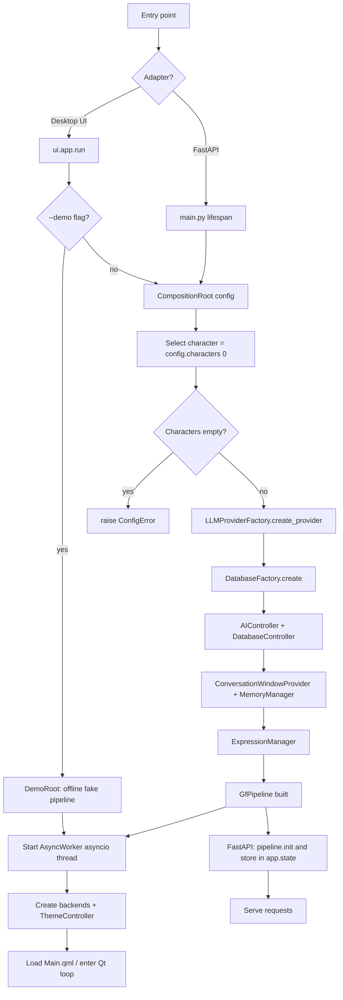
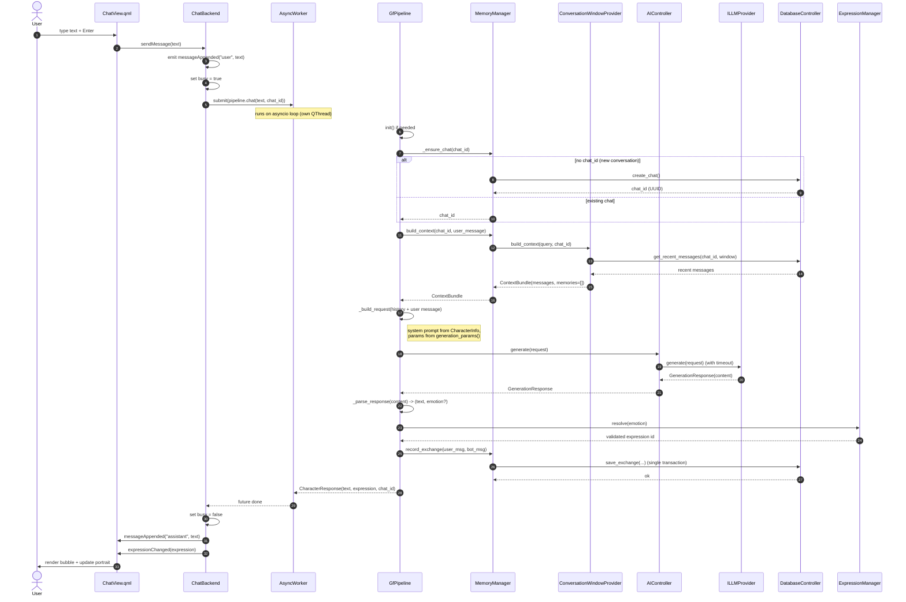
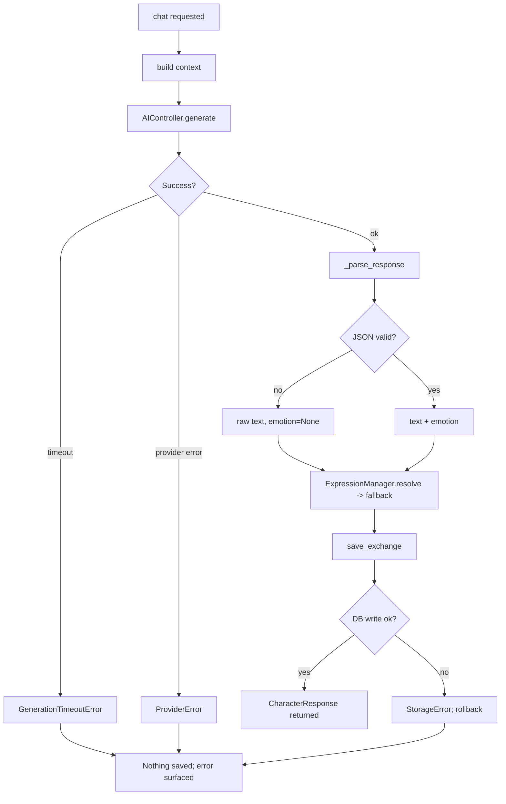
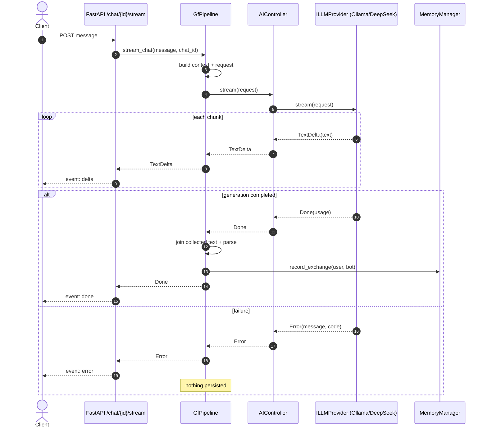
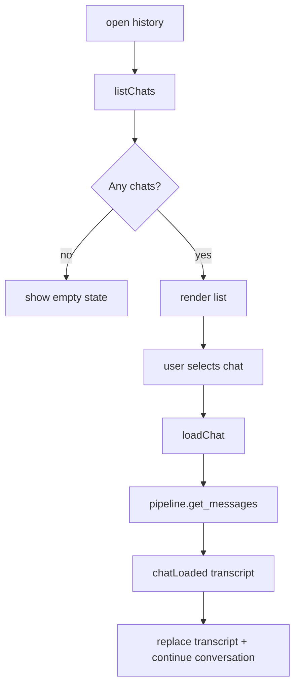
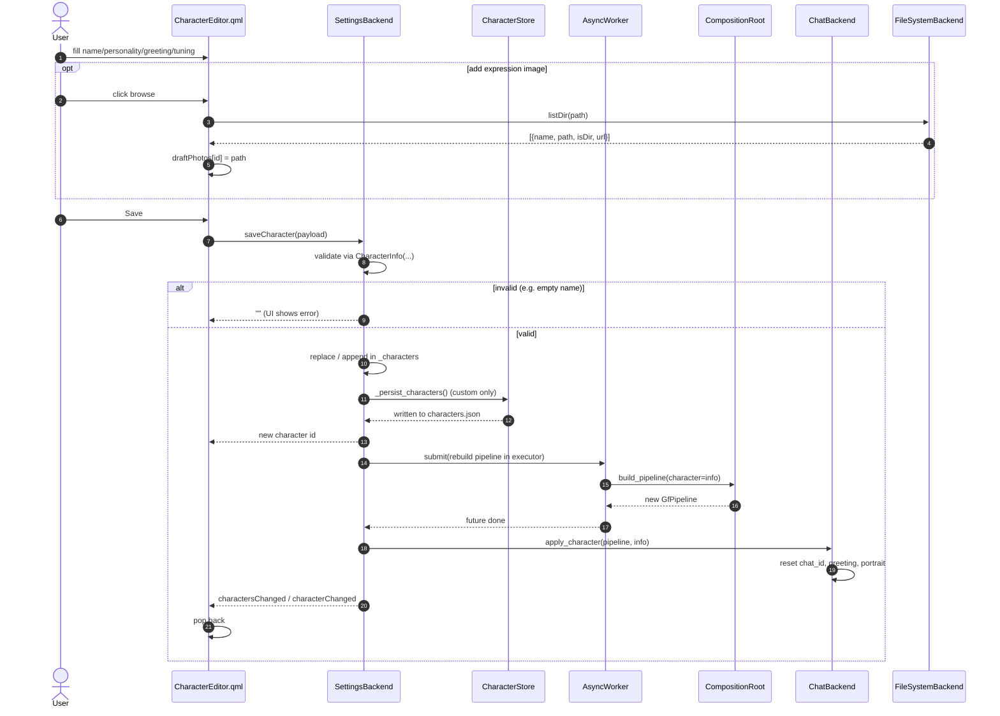
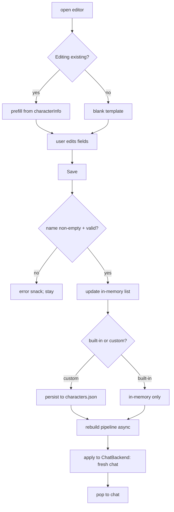
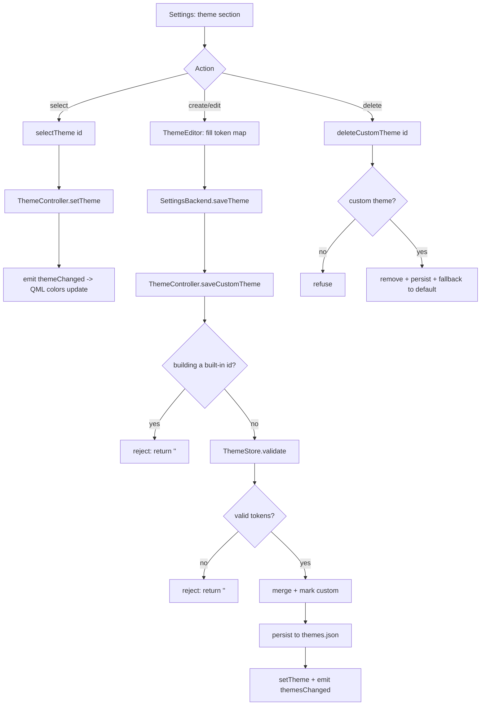
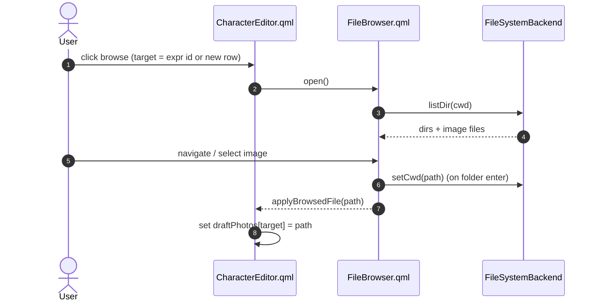
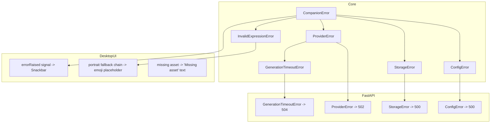

# Companion Framework — Runtime Flows

Sequence and activity diagrams for the critical scenarios. All diagrams are Mermaid and
render in GitHub, GitLab, Obsidian, and editors with Mermaid support.

Contents:

1. [Startup & composition](#1-startup--composition)
2. [Sending a prompt (write message)](#2-sending-a-prompt-write-message)
3. [Streaming a reply (SSE)](#3-streaming-a-reply-sse)
4. [Loading a previous chat](#4-loading-a-previous-chat)
5. [Creating / editing a bot (character)](#5-creating--editing-a-bot-character)
6. [Switching the active character](#6-switching-the-active-character)
7. [Theme management](#7-theme-management)
8. [Choosing a portrait image (file browser)](#8-choosing-a-portrait-image-file-browser)
9. [Error handling & fallbacks](#9-error-handling--fallbacks)

---

## 1. Startup & composition

The composition root is the single place where dependencies are assembled. The desktop
UI and the FastAPI adapter share the exact same `GfPipeline`.



**Key points**

- Factories are called **only** in the composition root (`src/ai_girlfriend/composition_root.py`).
- The pipeline is created lazily on demand for the UI and once at startup for FastAPI.
- `invoke demo` swaps the real root for `DemoRoot`, which returns a `DemoPipeline` with no
  network or disk.

---

## 2. Sending a prompt (write message)

The core path for a normal (non-streaming) turn. The QML UI calls
`ChatBackend.sendMessage`, which submits the coroutine to the `AsyncWorker`; the GUI
thread is never blocked.



**Failure branch**



---

## 3. Streaming a reply (SSE)

Used by `POST /chat/{chat_id}/stream`. The exchange is persisted **only** on the `Done`
event; partial text from a cancelled stream is not saved.



**Client cancellation:** if the client disconnects mid-stream, the async generator stops;
the `Done` branch never runs and the exchange is not saved.

---

## 4. Loading a previous chat

`ChatHistoryView.qml` lists stored chats and reopens one. The `ChatBackend` retargets its
active `chat_id` to the loaded conversation so subsequent messages continue it.

```mermaid
sequenceDiagram
    autonumber
    actor User
    participant HV as ChatHistoryView.qml
    participant CB as ChatBackend
    participant W as AsyncWorker
    participant P as GfPipeline
    participant DB as DatabaseController

    HV->>CB: listChats(50) (on open)
    CB->>W: submit(pipeline.list_chats(50))
    W->>P: list_chats(50)
    P->>DB: list_chats(50)
    DB-->>P: [ChatSummary]
    P-->>W: [ChatSummary]
    W-->>CB: future done
    CB-->>HV: chatsListed([{id, preview, count, updated}])

    User->>HV: tap a conversation
    HV->>CB: loadChat(chat_id)
    CB->>W: submit(pipeline.get_messages(chat_id))
    W->>P: get_messages(chat_id)
    P->>DB: get_messages(chat_id)
    DB-->>P: [Message]
    P-->>W: [Message]
    W-->>CB: future done
    CB->>CB: _chat_id = UUID(chat_id)
    CB-->>HV: chatLoaded(chat_id, transcript)
    HV->>HV: adoptTranscript(); pop back to chat
```



---

## 5. Creating / editing a bot (character)

Characters are edited in `CharacterEditor.qml`. Built-in characters come from
`config.json`; user characters are persisted to `characters.json` through
`CharacterStore`. After saving, `SettingsBackend` rebuilds the pipeline asynchronously.





**Delete:** custom characters can be deleted (`deleteCharacter`); built-in characters
cannot and the UI shows a message.

---

## 6. Switching the active character

```mermaid
sequenceDiagram
    autonumber
    actor User
    participant CP as CharacterPicker.qml
    participant SB as SettingsBackend
    participant W as AsyncWorker
    participant CR as CompositionRoot
    participant CB as ChatBackend
    participant QML as ChatView.qml

    User->>CP: select character
    CP->>SB: selectCharacter(character_id)
    SB->>SB: set busy = true
    SB->>W: submit(rebuild pipeline in executor)
    W->>CR: build_pipeline(character)
    CR-->>W: new GfPipeline
    W-->>SB: _on_built(future, id)
    SB->>CB: apply_character(pipeline, info)
    CB->>CB: fresh chat_id; emit characterChanged
    SB-->>QML: characterChanged -> clear transcript
    SB->>SB: set busy = false
```

---

## 7. Theme management

Themes are role-based Material 3 tokens. Built-in themes are in `ui/themes.py`; custom
themes are validated and persisted by `ThemeStore` to `themes.json`.



---

## 8. Choosing a portrait image (file browser)

QML's platform `FileDialog` is not always available, so an in-app read-only browser is
used instead (`FileSystemBackend` + `FileBrowser.qml`).



Only directories and known image suffixes are listed; unreadable directories yield an
empty list instead of raising.

---

## 9. Error handling & fallbacks



**Portrait fallback resolution** (`ChatBackend._expression_url`): walk candidates —
the requested id → `initial_expression` → `default` → any mapped asset — and return the
first image that exists on disk; otherwise return `''` so QML shows the emoji placeholder.

**Reliability guarantees**

- A generation failure saves nothing (no half exchange).
- Streaming persists only on `Done`.
- `InvalidExpressionError` never maps to an arbitrary filesystem path (assets are
  resolved through `ExpressionManager` with a `..` traversal guard).
- Custom character/theme files that are malformed are skipped rather than crashing the
  app.
